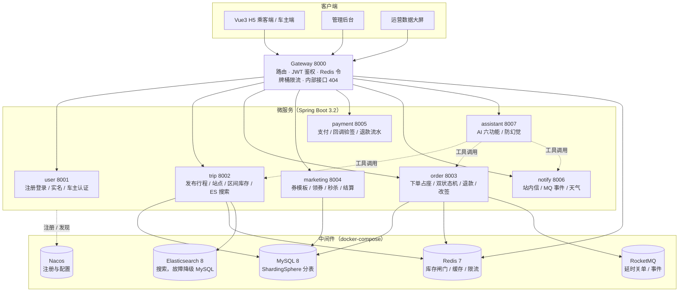
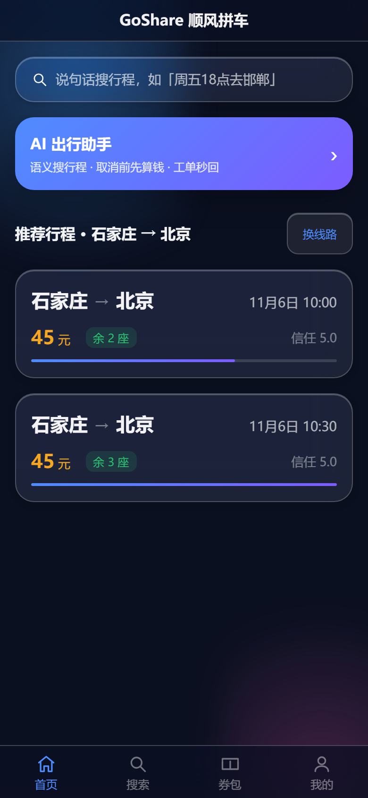
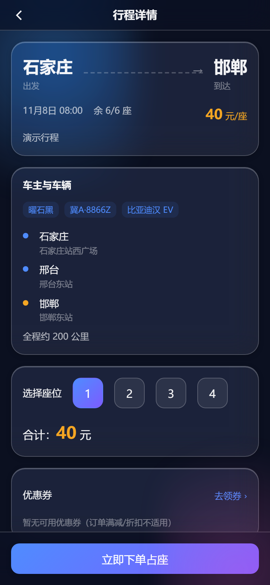
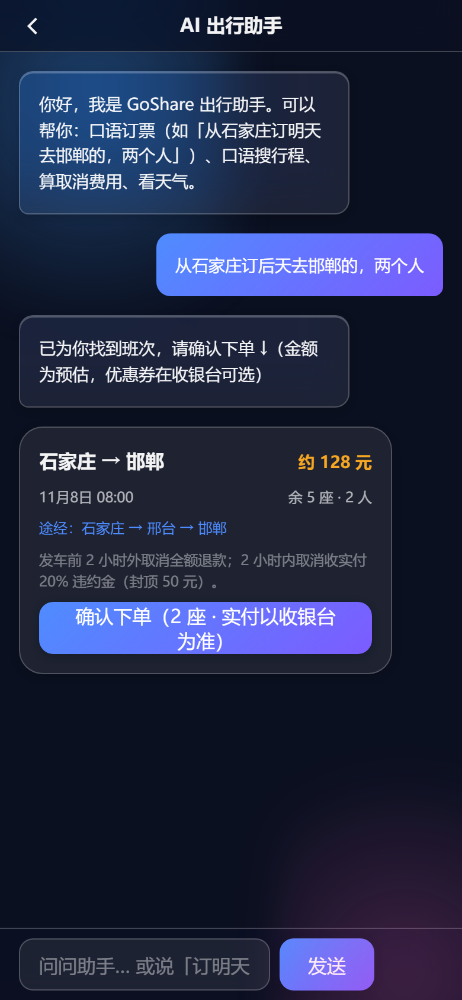
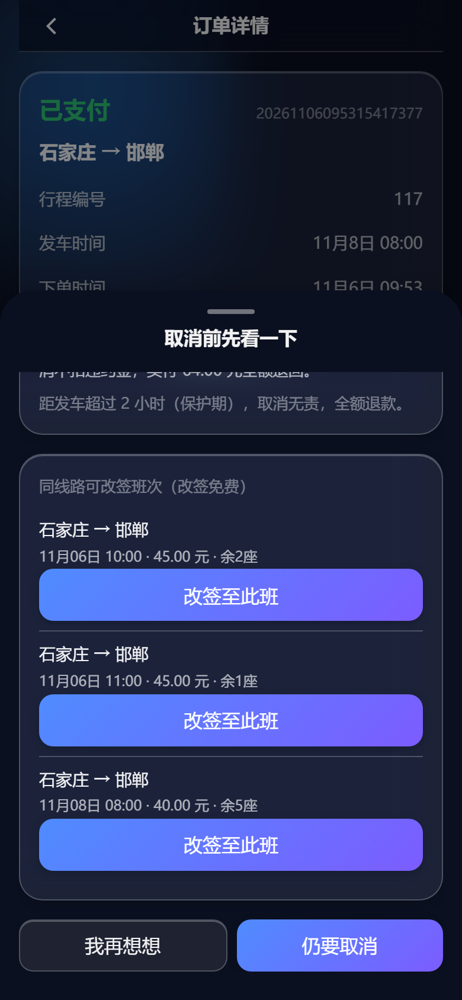
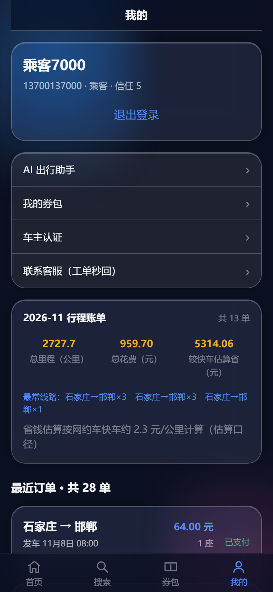
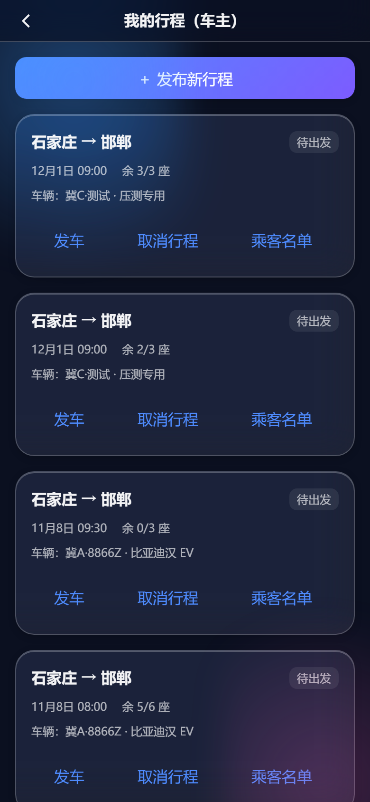
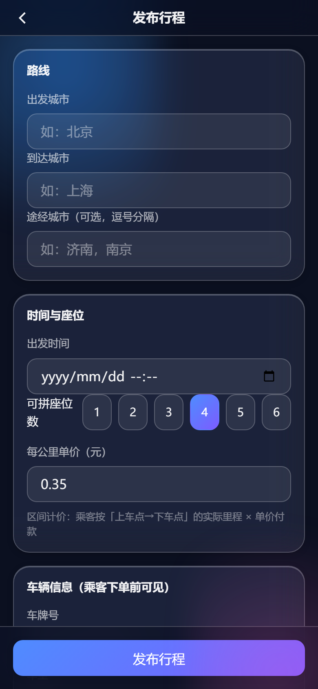
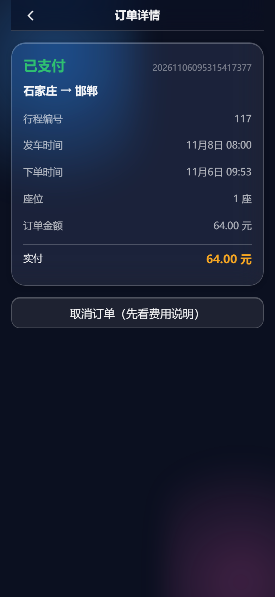
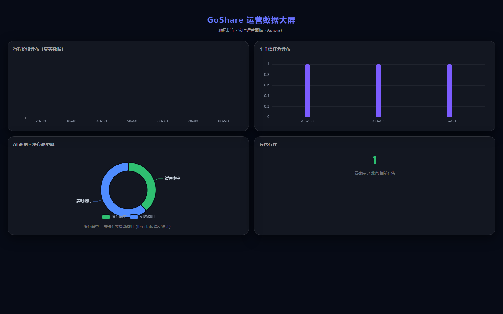

# GoShare · 顺风拼车平台

<p align="center">
  <b>不是"又一个 12306 仿写"，而是一个把「区间库存 / 交易一致性 / AI 防幻觉」三件事讲清楚的顺风拼车系统</b>
</p>

<p align="center">
  <a href="https://github.com/Zhe713/GoShare/actions/workflows/ci.yml"></a>
  
  
  
  
  
  
  
</p>

<p align="center">
  <a href="#-这是什么">这是什么</a> ·
  <a href="#-项目亮点">项目亮点</a> ·
  <a href="#-系统架构">系统架构</a> ·
  <a href="#-快速开始">快速开始</a> ·
  <a href="#-关键设计">关键设计</a> ·
  <a href="#-测试与质量">测试与质量</a>
</p>

---

## 这是什么

一个**求职作品级**的微服务顺风拼车平台：乘客搜索行程、车主发布拼座、按区间售座、下单支付、退款改签、履约评价，并内置一个**只讲真话**的 AI 出行助手。

与常见"电商 / 秒杀 / 12306 仿写"最大的区别在业务建模深度：

| 常见做法 | 本项目做法 |
|---|---|
| 行程只有「起点→终点」一个标量余座 | 行程有**站点序列**，`trip_segment` 按区间记账——**北京→济南满座不影响济南→上海继续卖** |
| 取消即报错 / 付了钱退不了 | 完整**退款域**：退款单 + 渠道流水 + 部分退款（改签差额）+ 状态机 |
| 下单成功即终态 | 订单 / 行程**双状态机** + 履约闭环（上车 → 到达 → 评价） |
| AI 助手当"聊天装饰" | 六个落到业务的 AI 功能 + **结构性防幻觉**（工具化取数 + 输出护栏 + 离线历法） |
| 并发靠"加个 Redis 锁" | Lua 原子扣减 + DB 条件更新兜底 + 幂等唯一索引，三层防超卖 |

> 个人学习 / 求职作品，**不面向生产**。依赖均为本地容器或免费公开 API，无任何私有服务。

---

## 项目亮点

### 业务建模：把"顺风车"真正建出来

- **区间库存**：行程拆成 `trip_stop` 站点序列 + `trip_segment` 区间余座。乘客可选任意上下车点，订单按**覆盖区间的交集**扣座，并做区间计价（每公里单价 × 区间里程）
- **双状态机**：行程 `待出发 → 满座 → 进行中 → 已完成 / 已取消`；订单 `CREATED → PAID → BOARDED → COMPLETED → REVIEWED`（另含 `REFUNDING / REFUNDED / CANCELLED / EXPIRED`）
- **退款闭环**：已支付订单可取消，按发车时间计算违约金，落退款单 + 渠道流水，库存原路回补
- **改签**：已支付订单免费改签到同线路新班次，差额自动部分退款
- **履约闭环**：车主确认上车 / 到达、乘客评价，乘客名单按行程聚合

### 交易一致性：钱和座不能对不上

- **三层防超卖**：Redis Lua 原子扣减（并发闸门）→ DB 条件更新（`remain_seats >= n` 且影响行数校验）→ 幂等键唯一索引（重复提交只建一单）
- **区间级 Lua 多 key 脚本**：一次校验订单覆盖的**所有**区间 key，任一不足整体失败，杜绝"扣了前段后段不足"的半扣状态
- **CAS 状态迁移**：`WHERE status = '期望状态'`，影响行数 0 即冲突，避免取消 / 支付回调 / 超时关单三方互踩
- **最终一致性**：RocketMQ 延时消息关单 + 定时扫描兜底 + 事件驱动通知，未引入 Seata

### AI 助手：结构性去幻觉，不是提示词工程

六个落到业务的功能（不只会聊天）：

| 功能 | 说明 | 数据来源 |
|---|---|---|
| **F1 对话式下单** | 说"从石家庄订明天去邯郸的，两个人"→ 生成确认卡（班次 / 余座 / 预估金额 / 取消政策），点确认才真正下单 | 规则解析 + 真实班次 + 确定性算价 |
| **F2 出发参谋** | "我几点出门？"→ 发车时间 − 通勤 − 提前到站 − 恶劣天气缓冲，给出具体出门时刻 | 订单 + 行程 + Open-Meteo 实时天气 |
| **F3 价格参谋** | "这个价贵吗？"→ 同线路近 30 天成交均价 / 最低价 / 中位数 | 真实订单聚合 |
| **F4 改签建议** | 取消挽留时给出同线路可改签班次，一键换班 | 真实班次 + 差额结算 |
| **F5 行程账单** | 月度拼车次数 / 里程 / 花费 / 较快车估算省钱 | 真实订单聚合 |
| **F6 节假日出行** | "距春节还有 N 天，节前一周是出行高峰" | lunar-java 离线历法（0 token） |

防幻觉三件套：**Function Calling 工具化取数**（8 个工具，数据只能来自系统）→ **输出护栏**（未调工具却输出硬断言则重试 / 降级）→ **离线确定性算法**（历法 / 价格 / 余座全部代码算）。省 token 四关卡：答案缓存 → 规则先答 → 固定前缀 → 夜间预生成，全量调用记账 `llm_call_log`。

### 工程质量

- 后端 **130+ 单测**，7 个模块 JaCoCo 行覆盖 ≥ 70%（模块级 check 独立拦截）
- **Playwright E2E 16/16**：真实浏览器跑主链路（登录 → 搜索 → 下单 → 支付 → 订单详情 → AI 对话）
- 并发压测：50 并发抢 3 座**恰好 3 单成功、零超卖**，区间独立性实测（A 满座 B 照卖）
- 全链路 **traceId**（Filter + RestTemplate 透传 + 日志 MDC）
- CI（GitHub Actions）：编译 → 单测 → 覆盖率门禁

---

## 系统架构



**服务与端口**

| 服务 | 端口 | 职责 |
|---|---|---|
| gateway | 8000 | 统一入口、鉴权、限流、内部接口屏蔽 |
| user | 8001 | 注册登录、实名、车主认证 |
| trip | 8002 | 发布行程、站点序列、区间库存、ES 搜索 |
| order | 8003 | 下单占座、状态机、退款、改签、履约 |
| marketing | 8004 | 券模板、领券、秒杀、用券结算 |
| payment | 8005 | 模拟支付、回调验签、退款流水 |
| notify | 8006 | 站内信、MQ 事件消费、天气 |
| assistant | 8007 | AI 出行助手（六功能）、工单摘要 |

---

## 技术栈

| 分类 | 选型 |
|---|---|
| 语言 / 框架 | Java 17、Spring Boot 3.2、Spring Cloud Alibaba（Nacos / Gateway / Sentinel） |
| 持久层 | MyBatis-Plus、ShardingSphere-JDBC（订单按 `passenger_id` 路由 `trip_order_0/1`） |
| 中间件 | MySQL 8、Redis 7、RocketMQ 4.9、Elasticsearch 8 |
| 前端 | Vue 3 + TypeScript（strict）+ Vite 5 + Pinia + Vue Router，三入口（H5 / admin / screen） |
| 前端工程 | 双级 Design Token、14 个 `g-ui` 组件、Vitest 单测、Playwright E2E |
| 测试 | JUnit 5 + Mockito、JaCoCo 覆盖率门禁、Playwright、Bash 并发压测 |
| AI | 可插拔 LLM 客户端（mock / OpenAI 兼容端点）、Function Calling、lunar-java |

---

## 快速开始

### 环境要求

JDK 17 · Maven 3.9+ · Node.js 18+ · Docker Desktop（或 Docker + Compose）

### 1. 启动中间件

```bash
cd docker
docker compose up -d          # MySQL / Redis / RocketMQ / ES / Nacos
```

首次启动会自动执行 `sql/` 下的建表与种子脚本。

### 2. 启动后端

```bash
cd server
mvn -DskipTests package

# 8 个服务，端口 8000-8007（也可用 IDE 逐个启动）
java -jar go-share-gateway-server/target/*.jar    --server.port=8000 &
java -jar go-share-user-server/target/*.jar       --server.port=8001 &
java -jar go-share-trip-server/target/*.jar       --server.port=8002 &
java -jar go-share-order-server/target/*.jar      --server.port=8003 &
java -jar go-share-marketing-server/target/*.jar  --server.port=8004 &
java -jar go-share-payment-server/target/*.jar    --server.port=8005 &
java -jar go-share-notify-server/target/*.jar     --server.port=8006 &
java -jar go-share-assistant-server/target/*.jar  --server.port=8007 &
```

> **多网卡机器提示**（Hyper-V / WSL）：若网关转发超时，检查 Nacos 注册 IP，
> 启动参数加 `--spring.cloud.nacos.discovery.ip=<可路由内网 IP>`。

### 3. 启动前端

```bash
cd web
npm install
npm run dev              # 同端口三入口
#   H5 乘客端 / 车主端   http://localhost:5173/
#   管理后台             http://localhost:5173/admin.html
#   运营数据大屏         http://localhost:5173/screen.html
```

### 4. 演示账号

| 角色 | 手机号 | 密码 |
|---|---|---|
| 车主 | 13900139000 | 123456 |
| 乘客 | 13700137000 | 123456 |

### 5. AI 助手配置（可选）

默认 `mock` 模式，**零密钥即可跑通全部功能**（规则关卡 + 工具链均为确定性实现）。接真实模型二选一：

**方式 A：本地加密保存（推荐，个人开发）**

```bash
node scripts/llm-key.mjs set     # 交互式粘贴 key，输入不回显
node scripts/llm-key.mjs show    # 查看（key 打码）
node scripts/llm-key.mjs clear   # 清除，回到 mock
```

key 不落明文、不进仓库：

| 文件 | 内容 |
|---|---|
| `~/.goshare/goshare-llm.properties` | `goshare.llm.mode=http` + `api-key=ENC:...`（AES-256-GCM 密文） |
| `~/.goshare/master.key` | 32 字节主密钥（与密文分文件存放，首次 `set` 自动生成） |

服务启动时由 `LlmSecretEnvironmentPostProcessor` 解密注入，日志会打印一行
`[llm-secret] 已加载本地加密 LLM 配置：mode=http，api-key=已解密`。
两者都在仓库目录之外，天然不会被 commit；换机器需重新 `set`。

**方式 B：环境变量（CI / 容器）**

```bash
export GOSHARE_LLM_MODE=http
export GOSHARE_LLM_API_KEY=你的key      # 或阿里云百炼 / 任意 OpenAI 兼容端点
export GOSHARE_LLM_HTTP_URL=https://dashscope.aliyuncs.com/compatible-mode/v1/chat/completions
```

> 优先级：环境变量 > 本地加密文件 > `application.yml` 默认值（mock）。
> 安全边界说明：本地加密防的是"明文被顺手拷走 / 误提交"，不是对抗本机管理员；生产请用 KMS。

### 密钥与配置安全

仓库里**没有任何真实密钥**，可以公开克隆运行：

| 配置 | 仓库默认值 | 说明 |
|---|---|---|
| `goshare.llm.api-key` | 空 + `mode: mock` | 接真模型用 `node scripts/llm-key.mjs set`（本地 AES-256-GCM 加密）或环境变量 |
| `goshare.jwt.secret` | `...please-change-in-prod...` | **部署前必须**设 `GOSHARE_JWT_SECRET`，否则知道仓库的人都能自己签 token |
| MySQL / Redis 密码 | `root123` / 无 | 仅本地 docker-compose 用，不要暴露到公网 |
| 内部接口 `X-Internal-Token` | 由配置注入 | 网关已禁止公网访问 `@InternalApi` 路径，服务端再校验一次 |

自查命令（改完配置或怀疑泄露时跑一遍）：

```bash
git grep -nE "sk-[a-zA-Z0-9]{8,}" $(git rev-list --all) | head    # 历史里有没有像密钥的字符串
git log --all -S"你的密钥片段" --oneline                          # 指定字符串出现过哪些提交
```


---

## 界面预览

<p align="center">
  
  
  
</p>
<p align="center"><sub>首页搜索 · 行程详情（车主与车辆信任信息）· AI 对话式下单确认卡</sub></p>

<p align="center">
  
  
  
</p>
<p align="center"><sub>取消挽留与一键改签 · 月度行程账单 · 车主乘客管理</sub></p>

<p align="center">
  
  
  
</p>
<p align="center"><sub>车主发布行程（站点 + 车辆）· 订单详情 · 客服工单（AI 摘要 + 回复草稿）</sub></p>

<p align="center">
  
</p>
<p align="center"><sub>运营数据大屏（真实聚合数据）</sub></p>

---

## 关键设计

### 1. 区间库存：一次建模解决三个下游问题

传统做法只存 `remain_seats` 一个标量。本项目行程有站点序列：

```
trip_stop:    [0]北京 → [1]济南 → [2]上海
trip_segment: [0,1]=2 座   [1,2]=2 座     ← 每个区间独立记账
```

买"北京→济南"只扣 `[0,1]`；买全程则同时扣 `[0,1]` 与 `[1,2]`。

**收益**：区间可售性正确（不再出现"中途区间有座却显示无座"）、区间计价可追溯（0.35 元/km × 547.7km = 191.70 元），并为顺路匹配 / 分段定价留出数据基础。

**并发闸门也是区间级**：Redis key 为 `trip:seg:{tripId}:{from}-{to}`，Lua 先检查订单覆盖的**全部**区间 key 再统一扣减。

### 2. 三层防超卖 + CAS 状态机

```
请求 → [1] Redis Lua 原子扣减（区间多 key，先检查后扣）
     → [2] DB 条件更新 remain_seats >= n（影响行数必须等于覆盖区间数）
     → [3] 幂等键唯一索引（同一 key 只建一单）
```

任一层失败都会回补 Redis 并回滚 DB（同事务）。取消 / 支付回调 / 超时关单全部走 `WHERE status='期望值'` 的 CAS，影响行数 0 即冲突。

**实测**：50 并发抢 3 座 → 恰好 3 单成功；区间 A 满座后区间 B 仍可独立售出 3 座。

### 3. 退款域：付了钱一定能退

- 取消已支付订单 → 计算违约金（发车 2h 外免费 / 2h 内 20% 封顶 50 元）→ 落 `refund_order` + `refund_transaction` → 库存回补 → MQ 事件通知
- 改签差额走**部分退款**：`payment` 保持 SUCCESS 不整单 REFUNDED，符合真实渠道语义

### 4. AI 结构性防幻觉

```
用户问题 → 关卡1 答案缓存（data-version 失效）
        → 关卡2 规则先答（历法 / 时间 / 费用，0 token 0 幻觉）
        → 关卡3 固定前缀 + 多轮上下文
        → 关卡4 模型 + Function Calling 工具取数
        → 输出护栏：未调工具却输出硬断言 → 重试 → 降级
        → llm_call_log 全量记账（token / 缓存命中 / 耗时）
```

模型没有"自己编数据"的机会：行程、余座、价格、天气、历法全部来自工具或确定性代码，模型只负责把结构化结果讲成人话。

---

## 测试与质量

```bash
# 后端单测 + JaCoCo 覆盖率门禁
cd server && mvn test

# 前端类型检查 + 单测 + 构建
cd web && npx vue-tsc --noEmit && npm test && npm run build

# E2E（需服务与前端 dev server 运行中）
cd web && npm run test:e2e

# 区间库存并发压测（需服务运行）
bash scripts/load-test-segment.sh
```

| 项 | 结果 |
|---|---|
| 后端单测 | 295 用例全绿；7 模块行覆盖 ≥ 70%（JaCoCo 模块级门禁） |
| 前端类型检查 | `vue-tsc` 0 错误 |
| E2E | 16/16 通过（主链路 / 订单详情 / 券包 / 导航 / AI 对话 6 个 spec） |
| 并发压测 | 50 并发抢 3 座：3 成功零超卖；Redis 与 DB 区间余座一致 |
| 压测报告 | [`reports/load-segment-20261105-REPORT.md`](reports/load-segment-20261105-REPORT.md) |

---

## 目录结构

```
GoShare/
├── server/                         # 后端 Maven 多模块（common / api / gateway + 8 服务）
│   ├── go-share-common/            #   公共：Result / 异常 / JWT / 内部接口令牌 / traceId
│   ├── go-share-gateway-server/
│   ├── go-share-user-server/
│   ├── go-share-trip-server/       # 站点序列 + 区间库存 + ES 搜索（故障降级）
│   ├── go-share-order-server/      # 下单 / 双状态机 / 退款 / 改签 / 履约
│   ├── go-share-marketing-server/  # 券模板 / 领券 / 秒杀 / 结算
│   ├── go-share-payment-server/    # 支付 / 回调验签 / 退款流水
│   ├── go-share-notify-server/     # 站内信 / MQ 事件 / 天气
│   └── go-share-assistant-server/  # AI 助手 / FC 工具 / 防幻觉护栏
├── web/                            # Vue3 前端（h5 / admin / screen 三入口 + g-ui 组件）
├── sql/                            # 建表与种子脚本（docker 启动自动执行）
├── docker/                         # docker-compose 本地环境
├── scripts/                        # 启动 / 清理 / 并发压测脚本
├── reports/                        # 压测报告
└── docs/                           # 方案、技术亮点、面试弹药、全量代码知识图谱
```

---

## 演进记录（阶段缩影）

| 阶段 | 内容 |
|---|---|
| 0 | 环境骨架：11 模块 Maven 工程 + 6 个中间件容器 |
| 1 | 核心链路：注册登录 → 发布 → 搜索 → 下单 → 支付 |
| 2 | 券体系：模板 / 领券 / 秒杀 / 锁定用券 / 结算 / 退券 |
| 3 | 治理与搜索：Nacos / Gateway 限流 / ES 降级 / 候补 / 分库分表 |
| 4 | 消息与压测：RocketMQ 延时关单 + 消费防重 + 并发不超卖 |
| 5 | AI 助手：语义搜索 / 取消挽留 / 工单摘要 / 省 token 四关卡 |
| 6 | 前端三端：H5 / 管理后台 / 运营大屏 + 组件库 |
| 7 | 测试收口：覆盖率门禁 / E2E / CI |
| 8 | **深度评审后重写**：区间库存 + 双状态机 + 退款域 + 改签 + 履约闭环 + 六个 AI 功能 |

更多设计与评审记录见 [`docs/`](docs/)。

---

## 已知限制（诚实说明）

- 单机 demo：8 个服务共用一个库，order 直接写 trip 座位表（未做服务级数据隔离）
- 未接真实支付渠道，`MOCK` 渠道即时到账（生产需异步回调 + 对账）
- 未用分布式事务（Seata），采用消息 + 幂等 + 状态机 + 定时扫描的最终一致方案
- 管理后台与数据大屏为演示级，非组件库级工程化
- 未覆盖 SSRF / 灰度 / 链路采样等生产能力

---

## License

[MIT](LICENSE) © 2026 GoShare

仅用于学习与技术交流，请勿用于商业用途；演示数据均为虚构。
